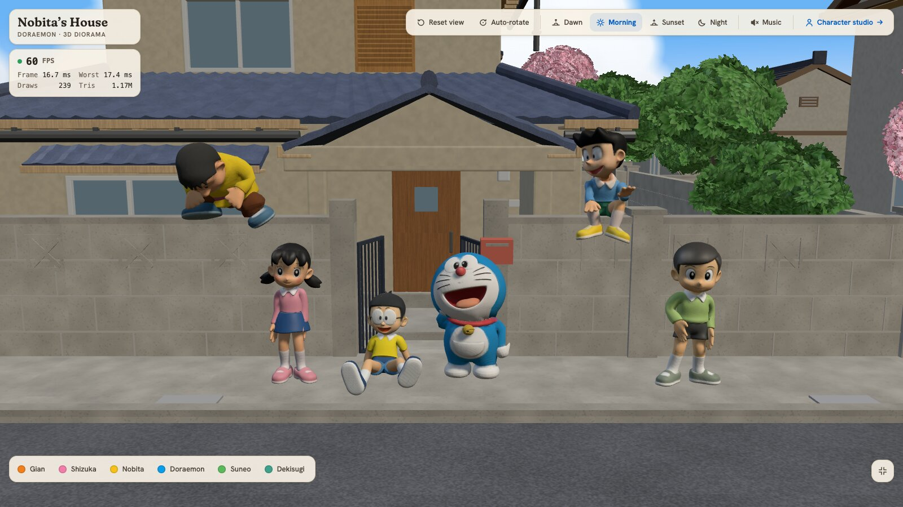
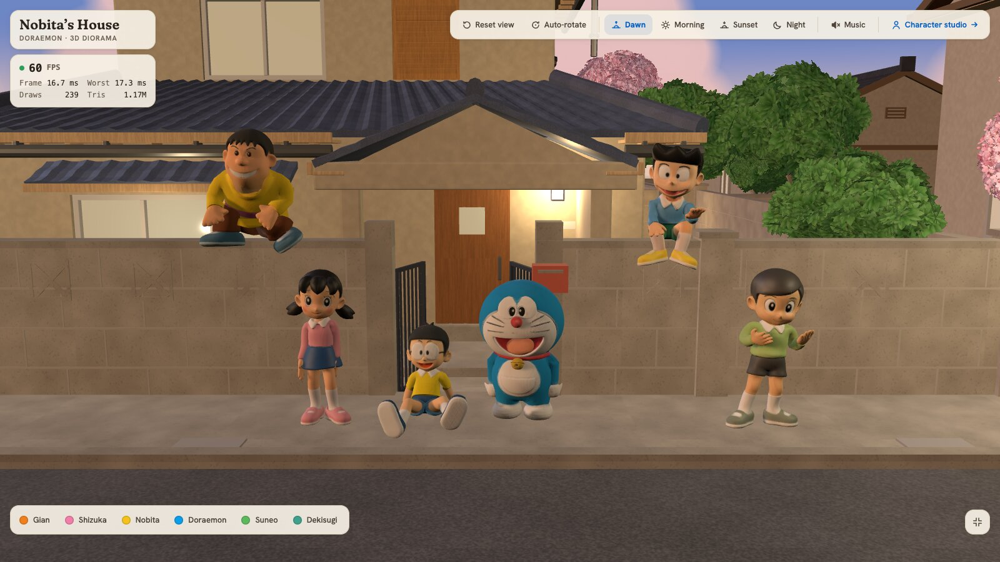
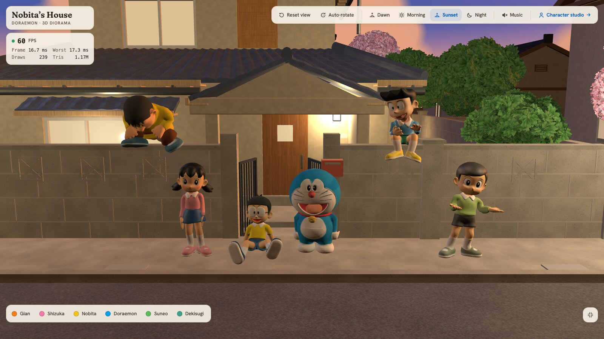
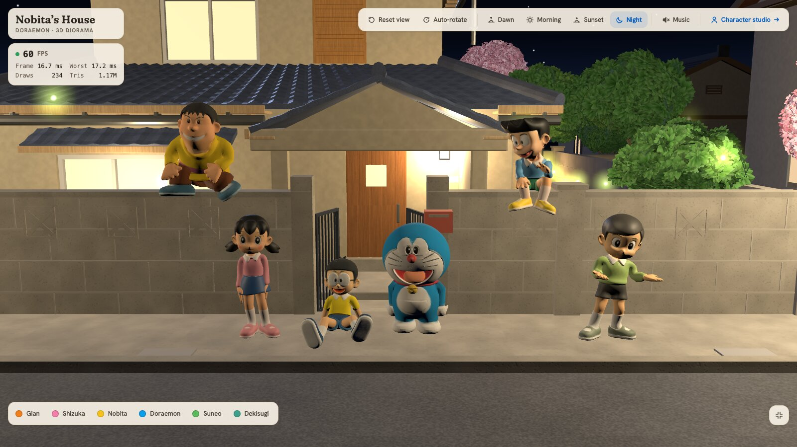
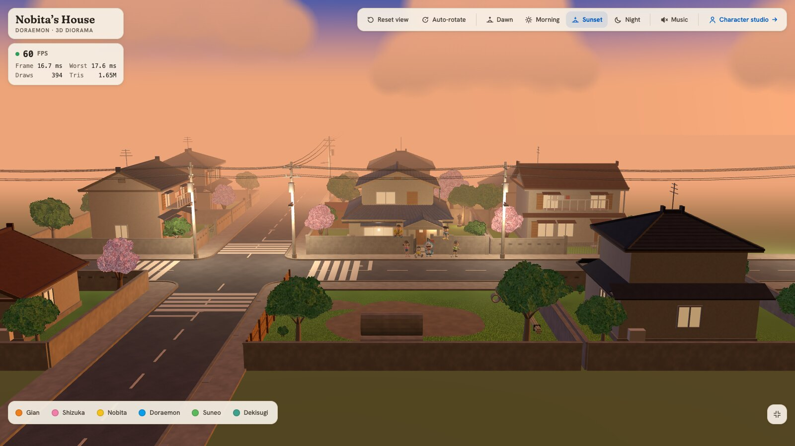
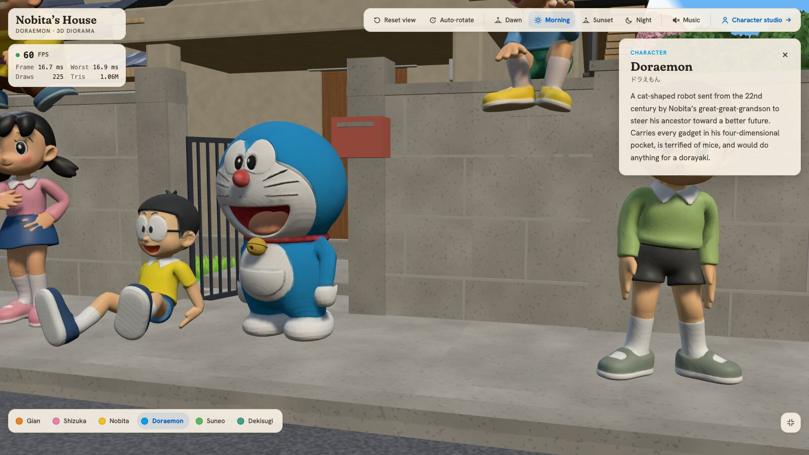
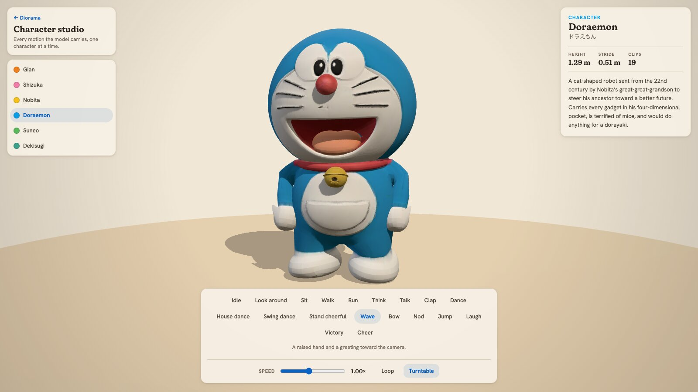

# Nobita's House — a 3D Doraemon diorama

A 3D web diorama of Nobita's house and the Japanese suburb around it, with Doraemon and friends gathered round the front gate. Orbit the block, change the time of day, click a character to meet them, or open the character studio to play every motion they carry.

**Live demo: [nobita-house.vercel.app](https://nobita-house.vercel.app/)**



## Features

- **Explorable neighbourhood.** Nobita's house stands on a crossroads with seven neighbour lots and, across the road, the vacant lot with its three concrete pipes. Drag to orbit, scroll to zoom, pan around the block.
- **Four times of day.** Dawn, morning, sunset and night each change the sky, sun, shadows, fog and clouds. At night the windows and street lamps light up, and there are stars, a moon and fireflies.
- **Rain.** A toggle beside the times of day closes the sky over any of them: grey clouds, soft shadows, closer haze, rain streaks and splashes. Open ground soaks through and dries off slowly; roads and paths shine and collect rippling puddles that mirror the sky and the street lamps. Everything under a roof, an eave or a tree stays dry — a top-down height capture of the scene decides what is sheltered, so no rain falls indoors. The rain is heard too (synthesized, muffled from inside the house, off with the Sound effects switch). On a rainy night the stars, moon and fireflies stay away.
- **Six characters.** Doraemon, Nobita, Shizuka, Gian, Suneo and Dekisugi, each rigged and animated. Some sit on the wall, some stand and talk. Click one, or use the roster, and the camera flies over and opens their info card.
- **Stroll.** One switch and the six split up: Nobita, Doraemon and Shizuka take the yard loop round the house, Gian, Suneo and Dekisugi the street loop round the block. Each child runs its own lap at its own pace, stops for a look around when it likes, and comes back to the gate when the switch goes off. The two sitters step down off the wall to walk, and step back up when they get home.
- **Character studio.** Put one character on a lit turntable and play any of their clips (idle, walk, run, wave, dance, laugh and more), with speed, loop and turntable controls.
- **Also:** auto-rotate, a reset-view button, background music you can toggle, a live FPS / draw-call / triangle panel, and a phone layout with a settings sheet.

## Screenshots

| Dawn | Sunset |
|---|---|
|  |  |

| Night | The whole block |
|---|---|
|  |  |

| Character card | Character studio |
|---|---|
|  |  |

## Pages

| Route | What it shows |
|---|---|
| `/` | The diorama: Nobita's house on its lot in the block, with the six characters at the gate; go inside through a window or the place menu, stand in any room, click a door to open it |
| `/characters/<id>` | The character studio: `doraemon`, `nobita`, `shizuka`, `jaian`, `suneo`, `dekisugi` |
| `/editor` | The house editor: Nobita's house rebuilt from its plan drawing, both floors under their roofs, whole or cut open at either floor, or seen from inside any room — from its corners, or through its doorway for the wet rooms and closets; click a door to open or shut it |

## Tech stack

| Layer | Choice |
|---|---|
| UI | React 19, TypeScript |
| 3D | three.js, @react-three/fiber, @react-three/drei, camera-controls |
| State / animation | zustand, motion |
| Build | Vite, bun |
| Quality | Biome (lint + format), Vitest |
| Hosting | Vercel |

The scene targets 60 FPS on desktop. Current numbers and budgets are in [docs/tech-stack.md](docs/tech-stack.md#measured-performance-m4-chrome-headless-over-cdp-real-metal-gpu-2026-09-11).

## Getting started

Requires [bun](https://bun.sh).

```sh
git clone https://github.com/lnanhkhoa/nobita-house-3d.git
cd nobita-house-3d
bun install
bun run dev        # http://localhost:5173
```

The optimised models in `public/models/` are committed, so the app runs straight after cloning. No environment variables are needed.

| Script | Does |
|---|---|
| `bun run dev` | Start the dev server |
| `bun run build` | Type-check and build to `dist/` |
| `bun run preview` | Serve the production build |
| `bun run lint` | Biome check |
| `bun run typecheck` | TypeScript, no emit |
| `bun run editor:textures` | Copy the surface tiles the house editor maps into `public/textures/editor/` |
| `bun run test` | Vitest: scene data, routing, lighting, placement, walk loop, music |

## Project structure

```
src/
  app.tsx          diorama page
  studio/          character studio page
  editor/          house editor page
  scene/           house, streets, neighbours, foliage, characters, lighting, camera
  data/            scene layout, characters, animation catalog, time-of-day presets
  state/           zustand stores
  ui/              panels, roster, info card, controls, music
public/models/     optimised GLB models
scripts/           asset pipeline: reference images, Blender builders, GLB optimisation
docs/              tech stack, asset pipeline, design guidelines, deployment
```

## How the models were made

The characters started as reference images, went through image-to-3D on Hyper3D Rodin, were rigged and animated with Mixamo, and were cleaned up in Blender. The streets, neighbour lots and plants are built procedurally by Blender Python scripts; Nobita's house is built in the browser (below). Everything is then compressed with gltf-transform (dedup, weld, texture resize, meshopt). The full runbook is in [docs/asset-pipeline.md](docs/asset-pipeline.md).

Nobita's house is not a model file. `src/editor/house/plan.ts` is the house as data, measured
from its own floor plan in `assets/drawings.jpg`: both storeys, fifteen rooms, every wall,
window, door and piece of furniture, the stair and the roofs of `assets/home.jpg`. The browser
builds it from that data, and the diorama and `/editor` build the same house:
`src/data/house-site.ts` sets it on the lot with its front door on the gate's axis, a 2 m stone
path from the gate to the porch, shrub beds and stepping stones in front, the washing line in
the west yard and a back yard with the shed behind. Inside, the camera stands where a person would — in a
corner of the room, or at the doorway of a room too small to stand in — and only turns, so it
never passes through a wall; every door, and the glass doors onto the garden, opens on a click.

## Documentation

- [docs/tech-stack.md](docs/tech-stack.md): architecture, conventions, performance
- [docs/asset-pipeline.md](docs/asset-pipeline.md): reference image to GLB
- [docs/design-guidelines.md](docs/design-guidelines.md): visual and UI direction
- [docs/deployment.md](docs/deployment.md): Vercel deploy and rollback

## Disclaimer

This is a non-commercial fan project for personal and portfolio use. Doraemon and all related characters are © Fujiko Pro / Shogakukan / TV Asahi. This project is not affiliated with or endorsed by the rights holders.
